<div align="center">

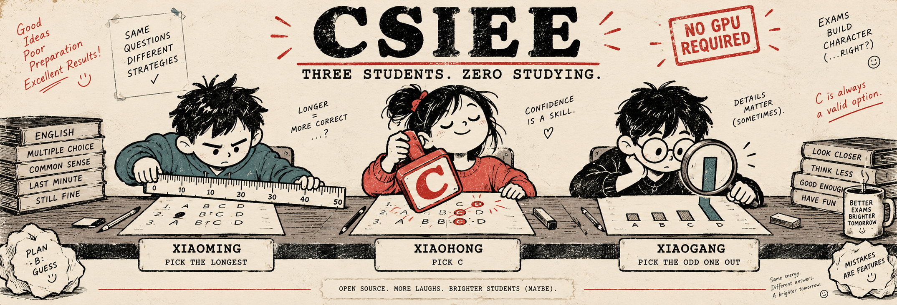

# Chinese Student in English Exam

### Your agent has a vector database. Xiaoming has a ruler.

**Option-only baselines for agent benchmarks. The premise is a joke. The measurements are real.**

[](https://github.com/ya-way/CSIEE/actions/workflows/ci.yml) [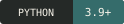](pyproject.toml) [](LICENSE)

[**The results**](#report-card) &nbsp; / &nbsp; [**The classmates**](#meet-the-class) &nbsp; / &nbsp; [**The ten exams**](#ten-exams-three-students-no-studying) &nbsp; / &nbsp; [**Run it yourself**](#run-it)

</div>

<br>

<picture>
  <source media="(max-width: 600px)" srcset="assets/exam-ticket-mobile.svg">
  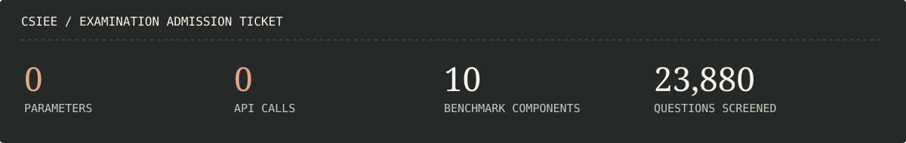
</picture>

The students never see the question, conversation, tools, or environment. **Only the answer choices.** Xiaoming measures them. Xiaohong picks C. Xiaogang looks for an outlier. Then they go home.

> **The research question:** how much of a multiple-choice agent benchmark can you answer without doing the task?

## Report card

Ten evaluated components across nine benchmark families. Memory, social reasoning, planning, research, personalization, and GUI understanding. **Native multiple-choice components only**; these are not end-to-end agent scores.

Accuracy on the recorded input order, seed **42**. “Chance” is the exact expected score of uniform guessing for each question's number of options.

<!-- report-card:start -->
| Benchmark / evaluated component | Questions | Chance | Xiaoming | Xiaohong | Xiaogang |
| :-- | --: | --: | --: | --: | --: |
| [PersonaMem-v2](results/classmates/personamem-v2/report.md) · text memory | 5,000 | 25.00% | 45.62% | 24.68% | 36.90% |
| [AgentSense](results/classmates/agentsense/report.md) · information reasoning | 1,863 | 25.00% | 49.87% | 25.17% | 49.44% |
| [ACPBench](results/classmates/acpbench/report.md) · seven planning tasks | 895 | 25.00% | 20.22% | 25.25% | 34.08% |
| [APTBench](results/classmates/aptbench/report.md) · seven English MCQ tasks | 4,215 | 20.84% | 16.39% | 20.76% | 11.81% |
| [AgentHop](results/classmates/agenthop/report.md) · research MCQs | 1,011 | 25.00% | 0.89% | 27.50% | 18.40% |
| [PERMA · Type 3](results/classmates/perma/report.md) · single- and multi-domain | 580 | 12.50% | 93.97% | 14.14% | 91.38% |
| [MemBench · msa subtask](results/classmates/membench-msa/report.md) · multi-session assistant only | 500 | 25.00% | 100.00% | 24.60% | 63.80% |
| [PersonaMem-v1 · 128k](results/classmates/personamem-v1/report.md) · earlier PersonaMem version | 2,612 | 25.00% | 44.33% | 21.09% | 52.53% |
| [GUI-World · MCQs](results/classmates/gui-world/report.md) · six GUI categories | 3,643 | 25.00% | 51.03% | 41.20% | 41.53% |
| [MMBench-GUI · L1](results/classmates/mmbench-gui-l1/report.md) · content understanding only | 3,561 | 22.08% | 46.28% | 28.39% | 36.06% |
<!-- report-card:end -->

> **Teacher's note:** Xiaoming gets 49.87% on AgentSense and 0.89% on AgentHop. The ruler has range. Unfortunately, so do the consequences.

The original five include two strong **reverse signals**: the heuristic systematically underperforms chance. They stay on the page. The new five were selected for stronger positive option-only signals, with their version and subtask boundaries labeled below.

<details>
<summary><strong>We moved the answers around. Here is what happened.</strong></summary>

Mean accuracy across **10 label-preserving option permutations** per question, using the same seed and unchanged strategies:

<!-- shuffle-card:start -->
| Benchmark | Xiaoming | Xiaohong | Xiaogang | Seeded random |
| :-- | --: | --: | --: | --: |
| PersonaMem-v2 | 45.59% | 25.22% | 37.05% | 25.11% |
| AgentSense | 49.69% | 25.10% | 49.57% | 24.78% |
| ACPBench | 19.49% | 24.41% | 33.33% | 24.77% |
| APTBench | 16.41% | 20.79% | 11.85% | 20.92% |
| AgentHop | 0.98% | 25.00% | 18.46% | 24.81% |
| PERMA · Type 3 | 93.93% | 12.31% | 91.31% | 12.17% |
| MemBench · msa subtask | 100.00% | 23.92% | 63.52% | 24.76% |
| PersonaMem-v1 · 128k | 44.29% | 24.69% | 52.51% | 25.34% |
| GUI-World · MCQs | 50.49% | 25.05% | 41.24% | 24.95% |
| MMBench-GUI · L1 | 45.46% | 22.03% | 35.87% | 21.65% |
<!-- shuffle-card:end -->

Xiaohong's faith in C returns to roughly chance. The length-based signals survive. PersonaMem-v2's initial order is a seeded reconstruction from its released correct/wrong answer fields, not the official evaluation order.

The [individual reports](results/classmates/README.md) include uncertainty intervals, permutation ranges, choice invariance, per-category counts, source revisions, and data hashes. Repeated permutations are sensitivity checks, not extra independent questions.

</details>

### Extra credit. Still no studying.

Five additions clear the PersonaMem-v2 reference of **+20.59 percentage points above chance after shuffling**. This criterion compares the best of the three unchanged rules, not raw accuracy or superiority over a paper model. MMBench-GUI has four or five choices; PERMA has eight.

<!-- added-signals:start -->
| Added component | Best unchanged rule | Shuffled accuracy | Chance | Lift over chance |
| :-- | :-- | --: | --: | --: |
| [PERMA · Type 3](results/classmates/perma/report.md) | Xiaoming | 93.93% | 12.50% | **+81.43 pp** |
| [MemBench · msa subtask](results/classmates/membench-msa/report.md) | Xiaoming | 100.00% | 25.00% | **+75.00 pp** |
| [PersonaMem-v1 · 128k](results/classmates/personamem-v1/report.md) | Xiaogang | 52.51% | 25.00% | **+27.51 pp** |
| [GUI-World · MCQs](results/classmates/gui-world/report.md) | Xiaoming | 50.49% | 25.00% | **+25.49 pp** |
| [MMBench-GUI · L1](results/classmates/mmbench-gui-l1/report.md) | Xiaoming | 45.46% | 22.08% | **+23.38 pp** |
<!-- added-signals:end -->

**Scope matters:** PersonaMem-v1 is an earlier version of the same family. MemBench is the **500-question multi-session assistant subtask**, selected after the full MemBench screen showed only +2.60 pp. These are five additional components, not five new independent benchmark families. All signals are exploratory; selection used these same datasets, with no held-out confirmation.

BixBench, Backtrader-Bench, FDABench, and the additional weak or negative pilots remain in the [screening ledger](docs/screening.md). We did not invent MCQs for open-ended tasks or tune a rule per benchmark.

## Meet the class

Three candidates. One shared commitment to inadequate preparation.

<picture>
  <source media="(max-width: 600px)" srcset="assets/class-roster-mobile.svg">
  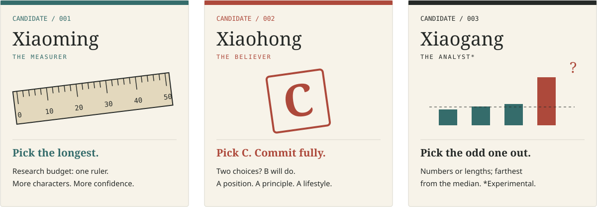
</picture>

<details>
<summary><strong>Their entire research agenda, in plain text</strong></summary>

| Student | Rule | Equipment |
| :-- | :-- | :-- |
| **Xiaoming** | Pick the longest option by stripped character count. | A ruler |
| **Xiaohong** | Pick C. Only two choices? Pick B. | Conviction |
| **Xiaogang** | Classify choices as compatible scalar numbers or text; pick the value or length farthest from the median. | A slightly larger ruler |

</details>

Xiaogang is **experimental**: his classifier is a regex. For ties, Xiaoming and Xiaogang prefer C (B with two choices) if it is tied, then the earliest tied option. [Exact rules, numeric parsing & limitations →](docs/methodology.md#the-three-rules)

<!-- personamem:start -->
## Ten exams. Three students. No studying.

[01 Memory](#personamem-v2) · [02 Social reasoning](#agentsense) · [03 Planning](#acpbench) · [04 Agentic potential](#aptbench) · [05 Research](#agenthop)

[06 PERMA](#perma--type-3) · [07 MemBench subtask](#membench--multi-session-assistant) · [08 PersonaMem-v1](#personamem-v1--128k) · [09 GUI-World](#gui-world) · [10 MMBench-GUI L1](#mmbench-gui--l1)

**The literature meets the stationery aisle.** Teal bars are published model results; red bars are our three option-only rules. Every baseline in the selected paper columns stays on the page, sorted high to low. Different inputs and evaluation pipelines mean these are contextual comparisons, not a matched agent leaderboard.

### PersonaMem-v2

*5,000 memory questions. No memories consulted.*

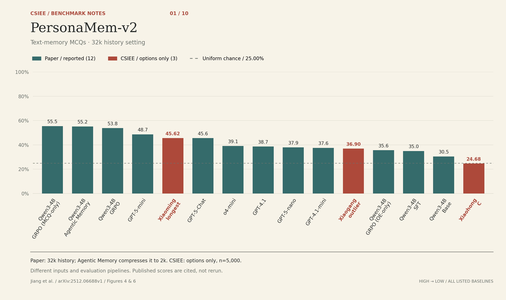

Text-memory MCQs · 32k history setting. Paper: 32k history; Agentic Memory compresses it to 2k. CSIEE: options only, n=5,000.

<details>
<summary><strong>Open the mark scheme — all 15 results and their sources</strong></summary>

| Method | Accuracy | Input / protocol | Source | Shuffled mean |
| :-- | --: | :-- | :-- | --: |
| Qwen3-4B · GRPO (MCQ-only) | 55.5% | 32k history | Paper: Figure 6 | — |
| Qwen3-4B · Agentic Memory | 55.2% | 2k memory* | Paper: Figure 6 | — |
| Qwen3-4B · GRPO | 53.8% | 32k history | Paper: Figure 6 | — |
| GPT-5-mini | 48.7% | 32k history | Paper: Figure 4 | — |
| **Xiaoming · longest** | **45.62%** | Options only | CSIEE: Saved CSIEE counts | 45.59% |
| GPT-5-Chat | 45.6% | 32k history | Paper: Figure 4 | — |
| o4-mini | 39.1% | 32k history | Paper: Figure 4 | — |
| GPT-4.1 | 38.7% | 32k history | Paper: Figure 4 | — |
| GPT-5-nano | 37.9% | 32k history | Paper: Figure 4 | — |
| GPT-4.1-mini | 37.6% | 32k history | Paper: Figure 4 | — |
| **Xiaogang · outlier** | **36.90%** | Options only | CSIEE: Saved CSIEE counts | 37.05% |
| Qwen3-4B · GRPO (OE-only) | 35.6% | 32k history | Paper: Figure 6 | — |
| Qwen3-4B · SFT | 35.0% | 32k history | Paper: Figure 6 | — |
| Qwen3-4B · Base | 30.5% | 32k history | Paper: Figure 6 | — |
| **Xiaohong · C** | **24.68%** | Options only | CSIEE: Saved CSIEE counts | 25.22% |
| Uniform chance | 25.00% | Options only | Analytical expectation | — |

</details>

[Source notes & exact scope](docs/personamem-comparison.md) · [PNG](assets/personamem-comparison.png) · [SVG](assets/personamem-comparison.svg) · [Back to results](#report-card)

### AgentSense

*No conversation. Still 49.87% for Xiaoming.*

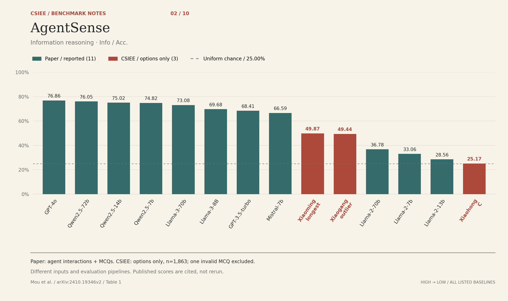

Information reasoning · Info / Acc. Paper: agent interactions + MCQs. CSIEE: options only, n=1,863; one invalid MCQ excluded.

<details>
<summary><strong>Open the mark scheme — all 14 results and their sources</strong></summary>

| Method | Accuracy | Input / protocol | Source | Shuffled mean |
| :-- | --: | :-- | :-- | --: |
| GPT-4o | 76.86% | Agent interaction + question + choices | Paper: Table 1, Info / Acc. column | — |
| Qwen2.5-72b | 76.05% | Agent interaction + question + choices | Paper: Table 1, Info / Acc. column | — |
| Qwen2.5-14b | 75.02% | Agent interaction + question + choices | Paper: Table 1, Info / Acc. column | — |
| Qwen2.5-7b | 74.82% | Agent interaction + question + choices | Paper: Table 1, Info / Acc. column | — |
| Llama-3-70b | 73.08% | Agent interaction + question + choices | Paper: Table 1, Info / Acc. column | — |
| Llama-3-8B | 69.68% | Agent interaction + question + choices | Paper: Table 1, Info / Acc. column | — |
| GPT-3.5-turbo | 68.41% | Agent interaction + question + choices | Paper: Table 1, Info / Acc. column | — |
| Mistral-7b | 66.59% | Agent interaction + question + choices | Paper: Table 1, Info / Acc. column | — |
| **Xiaoming · longest** | **49.87%** | Options only | CSIEE: Saved CSIEE counts | 49.69% |
| **Xiaogang · outlier** | **49.44%** | Options only | CSIEE: Saved CSIEE counts | 49.57% |
| Llama-2-70b | 36.78% | Agent interaction + question + choices | Paper: Table 1, Info / Acc. column | — |
| Llama-2-7b | 33.06% | Agent interaction + question + choices | Paper: Table 1, Info / Acc. column | — |
| Llama-2-13b | 28.56% | Agent interaction + question + choices | Paper: Table 1, Info / Acc. column | — |
| **Xiaohong · C** | **25.17%** | Options only | CSIEE: Saved CSIEE counts | 25.10% |
| Uniform chance | 25.00% | Options only | Analytical expectation | — |

</details>

[Source notes & exact scope](docs/agentsense-comparison.md) · [PNG](assets/agentsense-comparison.png) · [SVG](assets/agentsense-comparison.svg) · [Back to results](#report-card)

### ACPBench

*Xiaogang brought a slightly larger ruler.*

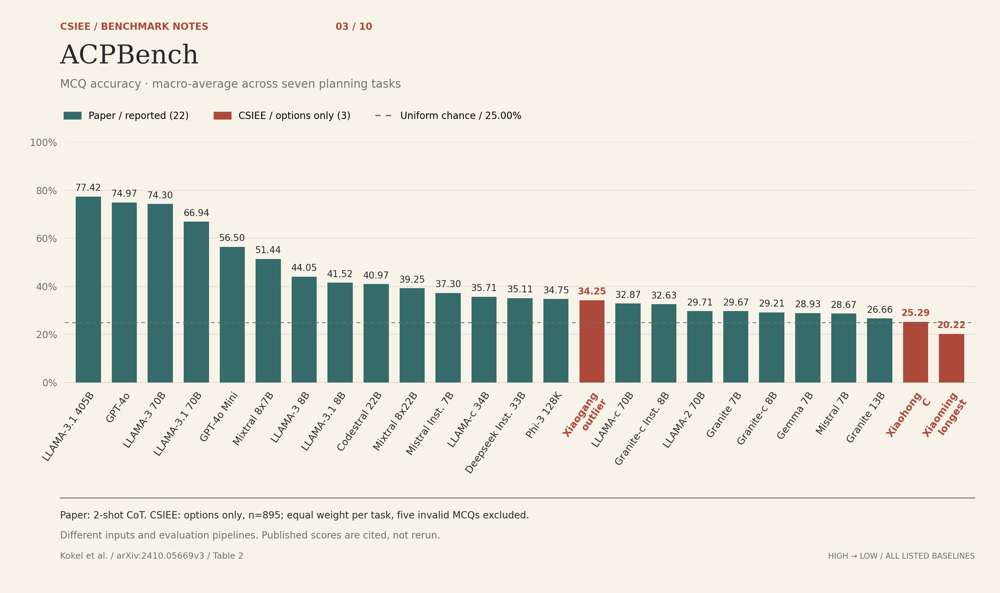

MCQ accuracy · macro-average across seven planning tasks. Paper: 2-shot CoT. CSIEE: options only, n=895; equal weight per task, five invalid MCQs excluded.

<details>
<summary><strong>Open the mark scheme — all 25 results and their sources</strong></summary>

| Method | Accuracy | Input / protocol | Source | Shuffled mean |
| :-- | --: | :-- | :-- | --: |
| LLAMA-3.1 405B | 77.42% | Question + choices; 2-shot CoT | Paper: Table 2, Mean / MCQ column | — |
| GPT-4o | 74.97% | Question + choices; 2-shot CoT | Paper: Table 2, Mean / MCQ column | — |
| LLAMA-3 70B | 74.30% | Question + choices; 2-shot CoT | Paper: Table 2, Mean / MCQ column | — |
| LLAMA-3.1 70B | 66.94% | Question + choices; 2-shot CoT | Paper: Table 2, Mean / MCQ column | — |
| GPT-4o Mini | 56.50% | Question + choices; 2-shot CoT | Paper: Table 2, Mean / MCQ column | — |
| Mixtral 8x7B | 51.44% | Question + choices; 2-shot CoT | Paper: Table 2, Mean / MCQ column | — |
| LLAMA-3 8B | 44.05% | Question + choices; 2-shot CoT | Paper: Table 2, Mean / MCQ column | — |
| LLAMA-3.1 8B | 41.52% | Question + choices; 2-shot CoT | Paper: Table 2, Mean / MCQ column | — |
| Codestral 22B | 40.97% | Question + choices; 2-shot CoT | Paper: Table 2, Mean / MCQ column | — |
| Mixtral 8x22B | 39.25% | Question + choices; 2-shot CoT | Paper: Table 2, Mean / MCQ column | — |
| Mistral Inst. 7B | 37.30% | Question + choices; 2-shot CoT | Paper: Table 2, Mean / MCQ column | — |
| LLAMA-c 34B | 35.71% | Question + choices; 2-shot CoT | Paper: Table 2, Mean / MCQ column | — |
| Deepseek Inst. 33B | 35.11% | Question + choices; 2-shot CoT | Paper: Table 2, Mean / MCQ column | — |
| Phi-3 128K | 34.75% | Question + choices; 2-shot CoT | Paper: Table 2, Mean / MCQ column | — |
| **Xiaogang · outlier** | **34.25%** | Options only | CSIEE: Saved CSIEE counts | — |
| LLAMA-c 70B | 32.87% | Question + choices; 2-shot CoT | Paper: Table 2, Mean / MCQ column | — |
| Granite-c Inst. 8B | 32.63% | Question + choices; 2-shot CoT | Paper: Table 2, Mean / MCQ column | — |
| LLAMA-2 70B | 29.71% | Question + choices; 2-shot CoT | Paper: Table 2, Mean / MCQ column | — |
| Granite 7B | 29.67% | Question + choices; 2-shot CoT | Paper: Table 2, Mean / MCQ column | — |
| Granite-c 8B | 29.21% | Question + choices; 2-shot CoT | Paper: Table 2, Mean / MCQ column | — |
| Gemma 7B | 28.93% | Question + choices; 2-shot CoT | Paper: Table 2, Mean / MCQ column | — |
| Mistral 7B | 28.67% | Question + choices; 2-shot CoT | Paper: Table 2, Mean / MCQ column | — |
| Granite 13B | 26.66% | Question + choices; 2-shot CoT | Paper: Table 2, Mean / MCQ column | — |
| **Xiaohong · C** | **25.29%** | Options only | CSIEE: Saved CSIEE counts | — |
| **Xiaoming · longest** | **20.22%** | Options only | CSIEE: Saved CSIEE counts | — |
| Uniform chance | 25.00% | Options only | Analytical expectation | — |

</details>

[Source notes & exact scope](docs/acpbench-comparison.md) · [PNG](assets/acpbench-comparison.png) · [SVG](assets/acpbench-comparison.svg) · [Back to results](#report-card)

### APTBench

*This is the part where the ruler loses.*

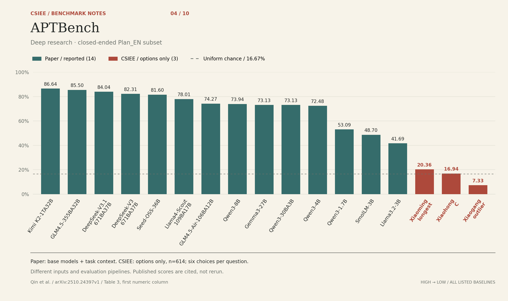

Deep research · closed-ended Plan_EN subset. Paper: base models + task context. CSIEE: options only, n=614; six choices per question.

<details>
<summary><strong>Open the mark scheme — all 17 results and their sources</strong></summary>

| Method | Accuracy | Input / protocol | Source | Shuffled mean |
| :-- | --: | :-- | :-- | --: |
| Kimi K2-1TA32B | 86.64% | Base model; task context + question + choices | Paper: Table 3, Closed-ended Question / Plan_EN (ACC), first numeric column | — |
| GLM4.5-355BA32B | 85.50% | Base model; task context + question + choices | Paper: Table 3, Closed-ended Question / Plan_EN (ACC), first numeric column | — |
| DeepSeek-V3.1-671BA37B | 84.04% | Base model; task context + question + choices | Paper: Table 3, Closed-ended Question / Plan_EN (ACC), first numeric column | — |
| DeepSeek-V3-671BA37B | 82.31% | Base model; task context + question + choices | Paper: Table 3, Closed-ended Question / Plan_EN (ACC), first numeric column | — |
| Seed-OSS-36B | 81.60% | Base model; task context + question + choices | Paper: Table 3, Closed-ended Question / Plan_EN (ACC), first numeric column | — |
| Llama4-Scout-109BA17B | 78.01% | Base model; task context + question + choices | Paper: Table 3, Closed-ended Question / Plan_EN (ACC), first numeric column | — |
| GLM4.5-Air-106BA12B | 74.27% | Base model; task context + question + choices | Paper: Table 3, Closed-ended Question / Plan_EN (ACC), first numeric column | — |
| Qwen3-8B | 73.94% | Base model; task context + question + choices | Paper: Table 3, Closed-ended Question / Plan_EN (ACC), first numeric column | — |
| Gemma3-27B | 73.13% | Base model; task context + question + choices | Paper: Table 3, Closed-ended Question / Plan_EN (ACC), first numeric column | — |
| Qwen3-30BA3B | 73.13% | Base model; task context + question + choices | Paper: Table 3, Closed-ended Question / Plan_EN (ACC), first numeric column | — |
| Qwen3-4B | 72.48% | Base model; task context + question + choices | Paper: Table 3, Closed-ended Question / Plan_EN (ACC), first numeric column | — |
| Qwen3-1.7B | 53.09% | Base model; task context + question + choices | Paper: Table 3, Closed-ended Question / Plan_EN (ACC), first numeric column | — |
| SmolLM-3B | 48.70% | Base model; task context + question + choices | Paper: Table 3, Closed-ended Question / Plan_EN (ACC), first numeric column | — |
| Llama3.2-3B | 41.69% | Base model; task context + question + choices | Paper: Table 3, Closed-ended Question / Plan_EN (ACC), first numeric column | — |
| **Xiaoming · longest** | **20.36%** | Options only | CSIEE: Saved CSIEE counts | — |
| **Xiaohong · C** | **16.94%** | Options only | CSIEE: Saved CSIEE counts | — |
| **Xiaogang · outlier** | **7.33%** | Options only | CSIEE: Saved CSIEE counts | — |
| Uniform chance | 16.67% | Options only | Analytical expectation | — |

</details>

[Source notes & exact scope](docs/aptbench-comparison.md) · [PNG](assets/aptbench-comparison.png) · [SVG](assets/aptbench-comparison.svg) · [Back to results](#report-card)

### AgentHop

*0.89%. Even a ruler has a bad day.*

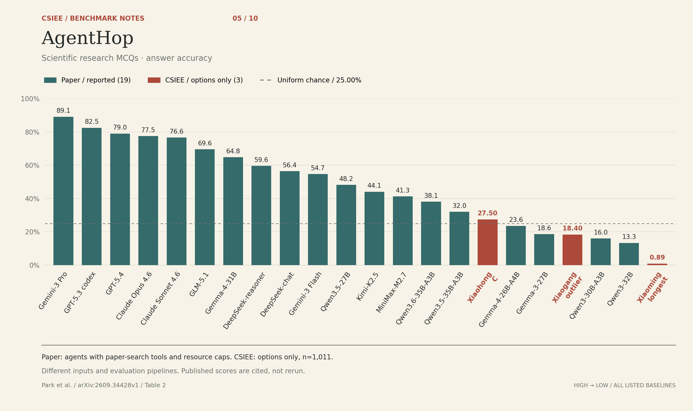

Scientific research MCQs · answer accuracy. Paper: agents with paper-search tools and resource caps. CSIEE: options only, n=1,011.

<details>
<summary><strong>Open the mark scheme — all 22 results and their sources</strong></summary>

| Method | Accuracy | Input / protocol | Source | Shuffled mean |
| :-- | --: | :-- | :-- | --: |
| Gemini-3 Pro | 89.1% | Question + choices + scientific-paper tools | Paper: Table 2, Outcome / Accuracy column | — |
| GPT-5.3 codex | 82.5% | Question + choices + scientific-paper tools | Paper: Table 2, Outcome / Accuracy column | — |
| GPT-5.4 | 79.0% | Question + choices + scientific-paper tools | Paper: Table 2, Outcome / Accuracy column | — |
| Claude Opus 4.6 | 77.5% | Question + choices + scientific-paper tools | Paper: Table 2, Outcome / Accuracy column | — |
| Claude Sonnet 4.6 | 76.6% | Question + choices + scientific-paper tools | Paper: Table 2, Outcome / Accuracy column | — |
| GLM-5.1 | 69.6% | Question + choices + scientific-paper tools | Paper: Table 2, Outcome / Accuracy column | — |
| Gemma-4-31B | 64.8% | Question + choices + scientific-paper tools | Paper: Table 2, Outcome / Accuracy column | — |
| DeepSeek-reasoner | 59.6% | Question + choices + scientific-paper tools | Paper: Table 2, Outcome / Accuracy column | — |
| DeepSeek-chat | 56.4% | Question + choices + scientific-paper tools | Paper: Table 2, Outcome / Accuracy column | — |
| Gemini-3 Flash | 54.7% | Question + choices + scientific-paper tools | Paper: Table 2, Outcome / Accuracy column | — |
| Qwen3.5-27B | 48.2% | Question + choices + scientific-paper tools | Paper: Table 2, Outcome / Accuracy column | — |
| Kimi-K2.5 | 44.1% | Question + choices + scientific-paper tools | Paper: Table 2, Outcome / Accuracy column | — |
| MiniMax-M2.7 | 41.3% | Question + choices + scientific-paper tools | Paper: Table 2, Outcome / Accuracy column | — |
| Qwen3.6-35B-A3B | 38.1% | Question + choices + scientific-paper tools | Paper: Table 2, Outcome / Accuracy column | — |
| Qwen3.5-35B-A3B | 32.0% | Question + choices + scientific-paper tools | Paper: Table 2, Outcome / Accuracy column | — |
| **Xiaohong · C** | **27.50%** | Options only | CSIEE: Saved CSIEE counts | 25.00% |
| Gemma-4-26B-A4B | 23.6% | Question + choices + scientific-paper tools | Paper: Table 2, Outcome / Accuracy column | — |
| Gemma-3-27B | 18.6% | Question + choices + scientific-paper tools | Paper: Table 2, Outcome / Accuracy column | — |
| **Xiaogang · outlier** | **18.40%** | Options only | CSIEE: Saved CSIEE counts | 18.46% |
| Qwen3-30B-A3B | 16.0% | Question + choices + scientific-paper tools | Paper: Table 2, Outcome / Accuracy column | — |
| Qwen3-32B | 13.3% | Question + choices + scientific-paper tools | Paper: Table 2, Outcome / Accuracy column | — |
| **Xiaoming · longest** | **0.89%** | Options only | CSIEE: Saved CSIEE counts | 0.98% |
| Uniform chance | 25.00% | Options only | Analytical expectation | — |

</details>

[Source notes & exact scope](docs/agenthop-comparison.md) · [PNG](assets/agenthop-comparison.png) · [SVG](assets/agenthop-comparison.svg) · [Back to results](#report-card)

### PERMA · Type 3

*Your memory system remembers preferences. The ruler remembers nothing.*

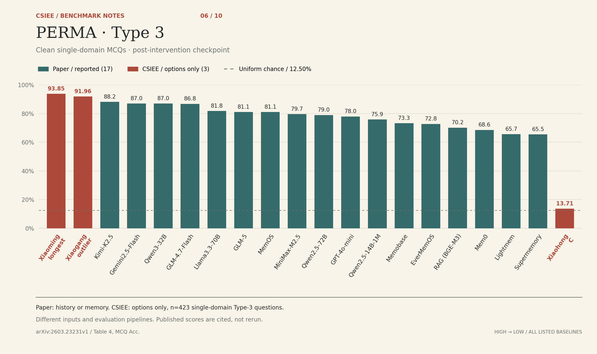

Clean single-domain MCQs · post-intervention checkpoint. Paper: history or memory. CSIEE: options only, n=423 single-domain Type-3 questions.

<details>
<summary><strong>Open the mark scheme — all 20 results and their sources</strong></summary>

| Method | Accuracy | Input / protocol | Source | Shuffled mean |
| :-- | --: | :-- | :-- | --: |
| **Xiaoming · longest** | **93.85%** | Options only | CSIEE: Saved CSIEE counts | — |
| **Xiaogang · outlier** | **91.96%** | Options only | CSIEE: Saved CSIEE counts | — |
| Kimi-K2.5 | 88.2% | Clean single-domain; history or memory | Paper: Table 4, MCQ Acc. (Clean, single-domain) | — |
| Gemini2.5-Flash | 87.0% | Clean single-domain; history or memory | Paper: Table 4, MCQ Acc. (Clean, single-domain) | — |
| Qwen3-32B | 87.0% | Clean single-domain; history or memory | Paper: Table 4, MCQ Acc. (Clean, single-domain) | — |
| GLM-4.7-Flash | 86.8% | Clean single-domain; history or memory | Paper: Table 4, MCQ Acc. (Clean, single-domain) | — |
| Llama3.3-70B | 81.8% | Clean single-domain; history or memory | Paper: Table 4, MCQ Acc. (Clean, single-domain) | — |
| GLM-5 | 81.1% | Clean single-domain; history or memory | Paper: Table 4, MCQ Acc. (Clean, single-domain) | — |
| MemOS | 81.1% | Clean single-domain; history or memory | Paper: Table 4, MCQ Acc. (Clean, single-domain) | — |
| MiniMax-M2.5 | 79.7% | Clean single-domain; history or memory | Paper: Table 4, MCQ Acc. (Clean, single-domain) | — |
| Qwen2.5-72B | 79.0% | Clean single-domain; history or memory | Paper: Table 4, MCQ Acc. (Clean, single-domain) | — |
| GPT-4o-mini | 78.0% | Clean single-domain; history or memory | Paper: Table 4, MCQ Acc. (Clean, single-domain) | — |
| Qwen2.5-14B-1M | 75.9% | Clean single-domain; history or memory | Paper: Table 4, MCQ Acc. (Clean, single-domain) | — |
| Memobase | 73.3% | Clean single-domain; history or memory | Paper: Table 4, MCQ Acc. (Clean, single-domain) | — |
| EverMemOS | 72.8% | Clean single-domain; history or memory | Paper: Table 4, MCQ Acc. (Clean, single-domain) | — |
| RAG (BGE-M3) | 70.2% | Clean single-domain; history or memory | Paper: Table 4, MCQ Acc. (Clean, single-domain) | — |
| Mem0 | 68.6% | Clean single-domain; history or memory | Paper: Table 4, MCQ Acc. (Clean, single-domain) | — |
| Lightmem | 65.7% | Clean single-domain; history or memory | Paper: Table 4, MCQ Acc. (Clean, single-domain) | — |
| Supermemory | 65.5% | Clean single-domain; history or memory | Paper: Table 4, MCQ Acc. (Clean, single-domain) | — |
| **Xiaohong · C** | **13.71%** | Options only | CSIEE: Saved CSIEE counts | — |
| Uniform chance | 12.50% | Options only | Analytical expectation | — |

</details>

[Source notes & exact scope](docs/perma-comparison.md) · [PNG](assets/perma-comparison.png) · [SVG](assets/perma-comparison.svg) · [Back to results](#report-card)

### MemBench · multi-session assistant

*A perfect score. On one very specific exam.*

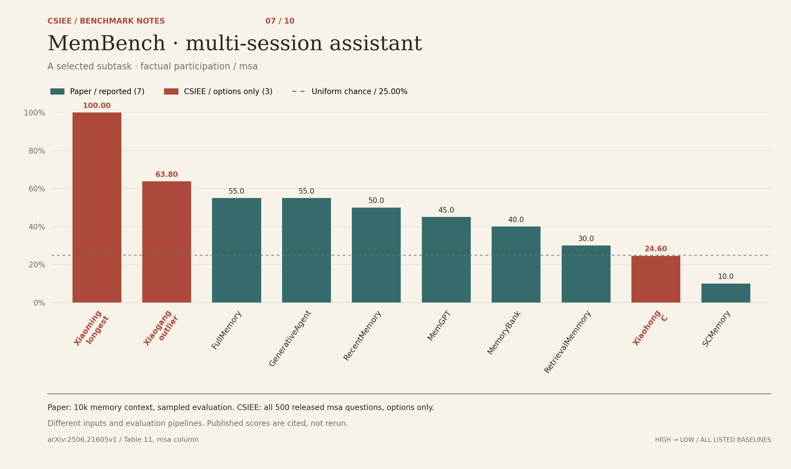

A selected subtask · factual participation / msa. Paper: 10k memory context, sampled evaluation. CSIEE: all 500 released msa questions, options only.

<details>
<summary><strong>Open the mark scheme — all 10 results and their sources</strong></summary>

| Method | Accuracy | Input / protocol | Source | Shuffled mean |
| :-- | --: | :-- | :-- | --: |
| **Xiaoming · longest** | **100.00%** | Options only | CSIEE: Saved CSIEE counts | 100.00% |
| **Xiaogang · outlier** | **63.80%** | Options only | CSIEE: Saved CSIEE counts | 63.52% |
| FullMemory | 55.0% | 10k factual participation; memory mechanism | Paper: Table 11, msa (multi-session assistant) column | — |
| GenerativeAgent | 55.0% | 10k factual participation; memory mechanism | Paper: Table 11, msa (multi-session assistant) column | — |
| RecentMemory | 50.0% | 10k factual participation; memory mechanism | Paper: Table 11, msa (multi-session assistant) column | — |
| MemGPT | 45.0% | 10k factual participation; memory mechanism | Paper: Table 11, msa (multi-session assistant) column | — |
| MemoryBank | 40.0% | 10k factual participation; memory mechanism | Paper: Table 11, msa (multi-session assistant) column | — |
| RetrievalMemmory | 30.0% | 10k factual participation; memory mechanism | Paper: Table 11, msa (multi-session assistant) column | — |
| **Xiaohong · C** | **24.60%** | Options only | CSIEE: Saved CSIEE counts | 23.92% |
| SCMemory | 10.0% | 10k factual participation; memory mechanism | Paper: Table 11, msa (multi-session assistant) column | — |
| Uniform chance | 25.00% | Options only | Analytical expectation | — |

</details>

[Source notes & exact scope](docs/membench-msa-comparison.md) · [PNG](assets/membench-msa-comparison.png) · [SVG](assets/membench-msa-comparison.svg) · [Back to results](#report-card)

### PersonaMem-v1 · 128k

*Same family. Earlier syllabus. Still suspiciously measurable.*

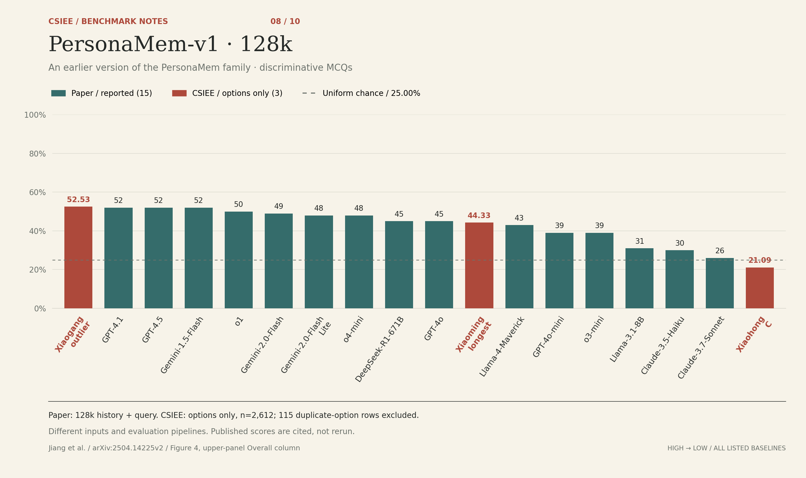

An earlier version of the PersonaMem family · discriminative MCQs. Paper: 128k history + query. CSIEE: options only, n=2,612; 115 duplicate-option rows excluded.

<details>
<summary><strong>Open the mark scheme — all 18 results and their sources</strong></summary>

| Method | Accuracy | Input / protocol | Source | Shuffled mean |
| :-- | --: | :-- | :-- | --: |
| **Xiaogang · outlier** | **52.53%** | Options only | CSIEE: Saved CSIEE counts | 52.51% |
| GPT-4.1 | 52% | 128k conversation history + question | Paper: Figure 4, upper panel (128k), Overall column | — |
| GPT-4.5 | 52% | 128k conversation history + question | Paper: Figure 4, upper panel (128k), Overall column | — |
| Gemini-1.5-Flash | 52% | 128k conversation history + question | Paper: Figure 4, upper panel (128k), Overall column | — |
| o1 | 50% | 128k conversation history + question | Paper: Figure 4, upper panel (128k), Overall column | — |
| Gemini-2.0-Flash | 49% | 128k conversation history + question | Paper: Figure 4, upper panel (128k), Overall column | — |
| Gemini-2.0-Flash-Lite | 48% | 128k conversation history + question | Paper: Figure 4, upper panel (128k), Overall column | — |
| o4-mini | 48% | 128k conversation history + question | Paper: Figure 4, upper panel (128k), Overall column | — |
| DeepSeek-R1-671B | 45% | 128k conversation history + question | Paper: Figure 4, upper panel (128k), Overall column | — |
| GPT-4o | 45% | 128k conversation history + question | Paper: Figure 4, upper panel (128k), Overall column | — |
| **Xiaoming · longest** | **44.33%** | Options only | CSIEE: Saved CSIEE counts | 44.29% |
| Llama-4-Maverick | 43% | 128k conversation history + question | Paper: Figure 4, upper panel (128k), Overall column | — |
| GPT-4o-mini | 39% | 128k conversation history + question | Paper: Figure 4, upper panel (128k), Overall column | — |
| o3-mini | 39% | 128k conversation history + question | Paper: Figure 4, upper panel (128k), Overall column | — |
| Llama-3.1-8B | 31% | 128k conversation history + question | Paper: Figure 4, upper panel (128k), Overall column | — |
| Claude-3.5-Haiku | 30% | 128k conversation history + question | Paper: Figure 4, upper panel (128k), Overall column | — |
| Claude-3.7-Sonnet | 26% | 128k conversation history + question | Paper: Figure 4, upper panel (128k), Overall column | — |
| **Xiaohong · C** | **21.09%** | Options only | CSIEE: Saved CSIEE counts | 24.69% |
| Uniform chance | 25.00% | Options only | Analytical expectation | — |

</details>

[Source notes & exact scope](docs/personamem-v1-comparison.md) · [PNG](assets/personamem-v1-comparison.png) · [SVG](assets/personamem-v1-comparison.svg) · [Back to results](#report-card)

### GUI-World

*The screen is off. The ruler is on.*

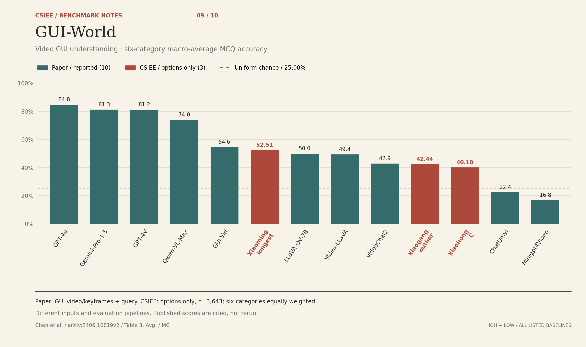

Video GUI understanding · six-category macro-average MCQ accuracy. Paper: GUI video/keyframes + query. CSIEE: options only, n=3,643; six categories equally weighted.

<details>
<summary><strong>Open the mark scheme — all 13 results and their sources</strong></summary>

| Method | Accuracy | Input / protocol | Source | Shuffled mean |
| :-- | --: | :-- | :-- | --: |
| GPT-4o | 84.8% | GUI video / keyframes + question | Paper: Table 3, Avg. / MC (macro-average of six categories) | — |
| Gemini-Pro-1.5 | 81.3% | GUI video / keyframes + question | Paper: Table 3, Avg. / MC (macro-average of six categories) | — |
| GPT-4V | 81.2% | GUI video / keyframes + question | Paper: Table 3, Avg. / MC (macro-average of six categories) | — |
| Qwen-VL-Max | 74.0% | GUI video / keyframes + question | Paper: Table 3, Avg. / MC (macro-average of six categories) | — |
| GUI-Vid | 54.6% | GUI video / keyframes + question | Paper: Table 3, Avg. / MC (macro-average of six categories) | — |
| **Xiaoming · longest** | **52.51%** | Options only | CSIEE: Saved CSIEE counts | — |
| LLaVA-OV-7B | 50.0% | GUI video / keyframes + question | Paper: Table 3, Avg. / MC (macro-average of six categories) | — |
| Video-LLaVA | 49.4% | GUI video / keyframes + question | Paper: Table 3, Avg. / MC (macro-average of six categories) | — |
| VideoChat2 | 42.9% | GUI video / keyframes + question | Paper: Table 3, Avg. / MC (macro-average of six categories) | — |
| **Xiaogang · outlier** | **42.44%** | Options only | CSIEE: Saved CSIEE counts | — |
| **Xiaohong · C** | **40.10%** | Options only | CSIEE: Saved CSIEE counts | — |
| ChatUnivi | 22.4% | GUI video / keyframes + question | Paper: Table 3, Avg. / MC (macro-average of six categories) | — |
| Minigpt4Video | 16.8% | GUI video / keyframes + question | Paper: Table 3, Avg. / MC (macro-average of six categories) | — |
| Uniform chance | 25.00% | Options only | Analytical expectation | — |

</details>

[Source notes & exact scope](docs/gui-world-comparison.md) · [PNG](assets/gui-world-comparison.png) · [SVG](assets/gui-world-comparison.svg) · [Back to results](#report-card)

### MMBench-GUI · L1

*No screenshot was harmed in this evaluation.*

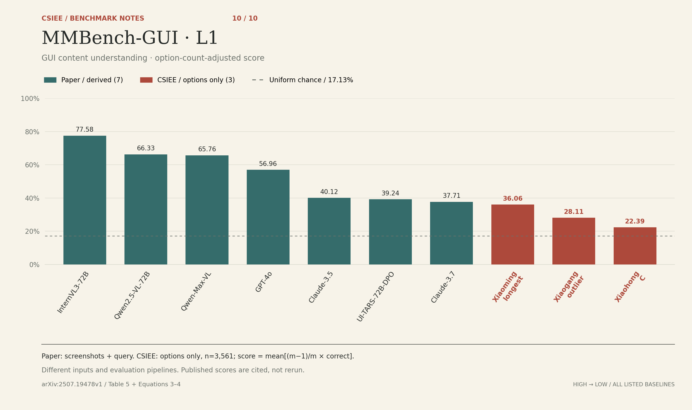

GUI content understanding · option-count-adjusted score. Paper: screenshots + query. CSIEE: options only, n=3,561; score = mean[(m−1)/m × correct].

<details>
<summary><strong>Open the mark scheme — all 10 results and their sources</strong></summary>

| Method | Accuracy | Input / protocol | Source | Shuffled mean |
| :-- | --: | :-- | :-- | --: |
| InternVL3-72B | 77.58% | Screenshot + question; mean of Easy/Medium/Hard | Paper: Table 5, Overall columns; arithmetic mean of three difficulties | — |
| Qwen2.5-VL-72B | 66.33% | Screenshot + question; mean of Easy/Medium/Hard | Paper: Table 5, Overall columns; arithmetic mean of three difficulties | — |
| Qwen-Max-VL | 65.76% | Screenshot + question; mean of Easy/Medium/Hard | Paper: Table 5, Overall columns; arithmetic mean of three difficulties | — |
| GPT-4o | 56.96% | Screenshot + question; mean of Easy/Medium/Hard | Paper: Table 5, Overall columns; arithmetic mean of three difficulties | — |
| Claude-3.5 | 40.12% | Screenshot + question; mean of Easy/Medium/Hard | Paper: Table 5, Overall columns; arithmetic mean of three difficulties | — |
| UI-TARS-72B-DPO | 39.24% | Screenshot + question; mean of Easy/Medium/Hard | Paper: Table 5, Overall columns; arithmetic mean of three difficulties | — |
| Claude-3.7 | 37.71% | Screenshot + question; mean of Easy/Medium/Hard | Paper: Table 5, Overall columns; arithmetic mean of three difficulties | — |
| **Xiaoming · longest** | **36.06%** | Options only | CSIEE: Saved CSIEE counts | — |
| **Xiaogang · outlier** | **28.11%** | Options only | CSIEE: Saved CSIEE counts | — |
| **Xiaohong · C** | **22.39%** | Options only | CSIEE: Saved CSIEE counts | — |
| Uniform chance | 17.13% | Options only | Analytical expectation | — |

</details>

[Source notes & exact scope](docs/mmbench-gui-l1-comparison.md) · [PNG](assets/mmbench-gui-l1-comparison.png) · [SVG](assets/mmbench-gui-l1-comparison.svg) · [Back to results](#report-card)

<!-- personamem:end -->

## Run it

Python **3.9+**. No runtime dependencies. No API key. No motivational speech.

```bash
git clone https://github.com/ya-way/CSIEE.git
cd CSIEE
python -m pip install .

# A tiny synthetic fixture: tests the plumbing, proves no scientific point.
csiee eval data/demo.jsonl --shuffles 10 --output results/local/demo

# Download pinned releases and reproduce the ten-component report card.
csiee suite --seed 42 --shuffles 10 --output results/local/suite

# Include all three additional screened datasets.
csiee suite --all --seed 42 --shuffles 10 --output results/local/all
```

Dataset downloads require internet access; guessing and evaluation run locally. Downloads stay in ignored `data/raw/`. Existing suite inputs are checked against their source manifests. Reports contain `summary.json`, `report.md`, and `predictions.jsonl`.

<details>
<summary><strong>Try all three classmates</strong></summary>

```console
$ csiee guess "Yes" "No" "It depends on a surprisingly elaborate series of circumstances" "Maybe" --strategy xiaoming
{"strategy": "xiaoming", "index": 2, "label": "C", "option": "It depends on a surprisingly elaborate series of circumstances"}

$ csiee guess "A reasonable answer" "Another reasonable answer" "C" "An excellent answer" --strategy xiaohong
{"strategy": "xiaohong", "index": 2, "label": "C", "option": "C"}

$ csiee guess 10 11 12 99 --strategy xiaogang
{"strategy": "xiaogang", "index": 3, "label": "D", "option": "99"}
```

</details>

<details>
<summary><strong>Bring your own exam</strong></summary>

One question per JSONL line, with a **zero-based** answer index:

```json
{"id":"q1","options":["10","11","12","99"],"answer":3,"category":"demo"}
```

```bash
csiee eval my-exam.jsonl --seed 42 --shuffles 10 --output results/local/my-exam
python -m unittest discover -s tests -v
```

Options must contain 2–26 nonempty, distinct strings. IDs must be unique. The predictor receives only the option strings; answer labels stay in the evaluator. The default report includes all three students and a seeded random baseline.

</details>

## Questions from the back row

**Did you beat an agent?**

We measured guessing from choices alone. We did not run agents, tools, retrieval, or environments. There is no apples-to-agents leaderboard here.

**Does this prove a benchmark is broken?**

No. It identifies answer-option patterns worth investigating. Correlated questions, subset selection, and exploratory screening limit the conclusions. [Methods and limitations →](docs/methodology.md)

**Is Xiaogang intelligent?**

He brought `statistics.median` to an exam. Please respect his journey. Only 163 of the 23,880 featured questions use his numeric route; the rest use character length.

**Where did Lite / Pro / Pro Max go?**

They graduated into [legacy ablations](docs/methodology.md#legacy-ablations). Their CLI names and earlier reports still work; the current cast is Xiaoming, Xiaohong, and Xiaogang.


## Join the examination board

Found another shortcut? Bring a rule, a pinned dataset and the embarrassing results too.

| I want to… | Start here |
| :-- | :-- |
| Add a strategy or benchmark | [Contributing guide](CONTRIBUTING.md) |
| Check every result, including weak signals | [Full reports and screening record](results/classmates/README.md) |
| Audit what was included and excluded | [Screening ledger](docs/screening.md) · [Methods](docs/methodology.md) |
| Reuse the figures | [PNG / SVG gallery & sources](docs/benchmark-comparisons.md) |
| Report a problem or propose an experiment | [Open an issue](https://github.com/ya-way/CSIEE/issues/new) |

Original code is [MIT-licensed](LICENSE). Upstream datasets retain their own terms; raw benchmark content is not committed. The [illustration and original vector artwork](assets/README.md) belong to this project's visual identity.

<br>

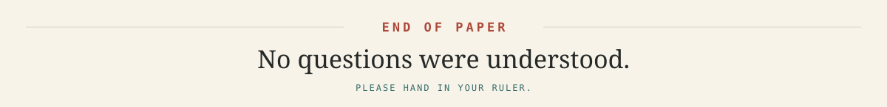

<div align="center"><sub>Built with no understanding of the question. &nbsp; · &nbsp; <a href="#chinese-student-in-english-exam">Back to the top ↑</a></sub></div>
